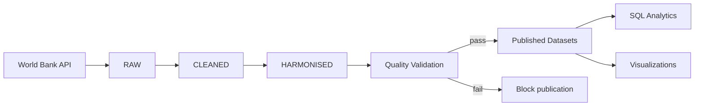
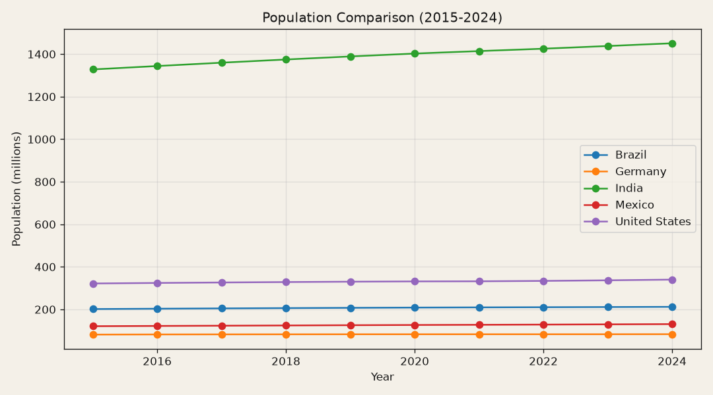
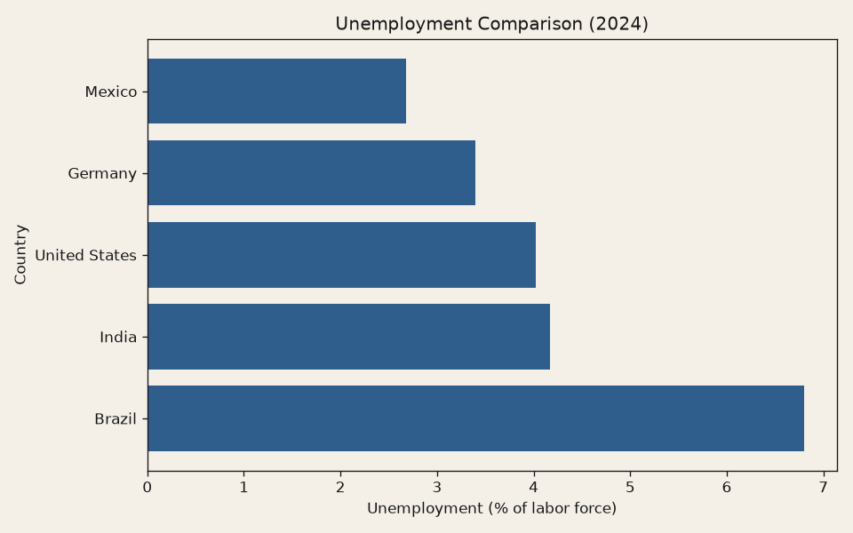

# Public Data Integration & Harmonization Pipeline

An automated Python and SQL pipeline that transforms raw public socioeconomic data into validated, analytics-ready datasets.

## The problem

Public data sources often contain different structures, inconsistent country identifiers, different measurement units, missing observations, and inconsistent metadata. These issues complicate cross-country analysis and delay insight.

## The solution

The pipeline retrieves five World Bank indicators for five countries from 2015 to 2024, preserves the raw responses, cleans and harmonizes the data, validates quality, and publishes analytics-ready outputs.



Each stage has a short responsibility:

- **RAW** retrieves and preserves the original API responses.
- **CLEANED** normalizes columns, types, missing values, and duplicates.
- **HARMONISED** standardizes ISO-3 country codes, names, years, and units.
- **Quality Validation** runs structural, completeness, uniqueness, validity, consistency, and time-series checks.
- **Published Datasets** writes CSV, Parquet, and DuckDB only when validation passes.

## Results

| Metric | Value |
|---|---:|
| Countries | 5 |
| Indicators | 5 |
| Records extracted | 250 |
| Valid records | 250 |
| Missing observations | 0 |
| Rejected records | 0 |
| Quality errors | 0 |
| Quality warnings | 1 |
| Automated tests | 28 passing |
| GitHub Actions workflows executed | 2 |

The single warning is a 119.5% year-over-year increase in the USA unemployment indicator in 2020, consistent with the COVID-19 period. Zero missing observations reflects the current selected dataset and execution, not a general guarantee of complete coverage.

Indicators:

| Indicator | Identifier | Unit |
|---|---|---|
| Population, total | SP.POP.TOTL | People |
| GDP per capita | NY.GDP.PCAP.CD | Current US$ |
| Life expectancy at birth | SP.DYN.LE00.IN | Years |
| Unemployment, total | SL.UEM.TOTL.ZS | Percentage |
| Access to electricity | EG.ELC.ACCS.ZS | Percentage |

## Data visualization

GDP per capita trends across countries:


Life expectancy trends:


Population comparison:



Unemployment comparison:



Data coverage by country and indicator:


All charts use actual pipeline outputs. Additional generated charts are available in `reports/figures/`.

## Technology

Python, Pandas, Requests, PyArrow, DuckDB, Pytest, Matplotlib, GitHub Actions.

## Engineering capabilities

- **API integration:** World Bank API client with pagination, retries, and timeouts.
- **Raw data preservation:** original responses stored with extraction timestamps.
- **Cleaning and harmonization:** normalized columns, standardized identifiers, years, and units.
- **Data quality:** automated checks with a publication gate that blocks invalid datasets.
- **SQL analytics:** DuckDB queries over the published dataset.
- **Automated testing:** 28 unit, integration, and end-to-end tests using controlled fixtures.
- **Scheduled execution:** CI on push and pull requests plus a weekly data refresh.

## How to run

```bash
pip install -r requirements.txt -r requirements-dev.txt
python main.py
python -m pytest
```

Outputs are written to `data/` and `reports/figures/`.

## Limitations

- One data provider.
- Five countries and five indicators.
- Static visualizations.
- No interactive dashboard.
- No incremental data versioning.
- No production-grade orchestration.

## Disclaimer

This is an independent portfolio project inspired by publicly described Data Pipeline Specialist responsibilities. It is not affiliated with or endorsed by YouthShare. Only publicly available data is used.

## Documentation

- Architecture: `docs/ARCHITECTURE.md`
- Data model: `docs/DATA_MODEL.md`
- Data quality: `docs/DATA_QUALITY.md`
- Data dictionary: `docs/DATA_DICTIONARY.md`
