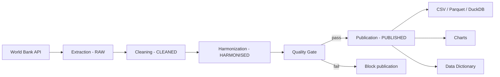
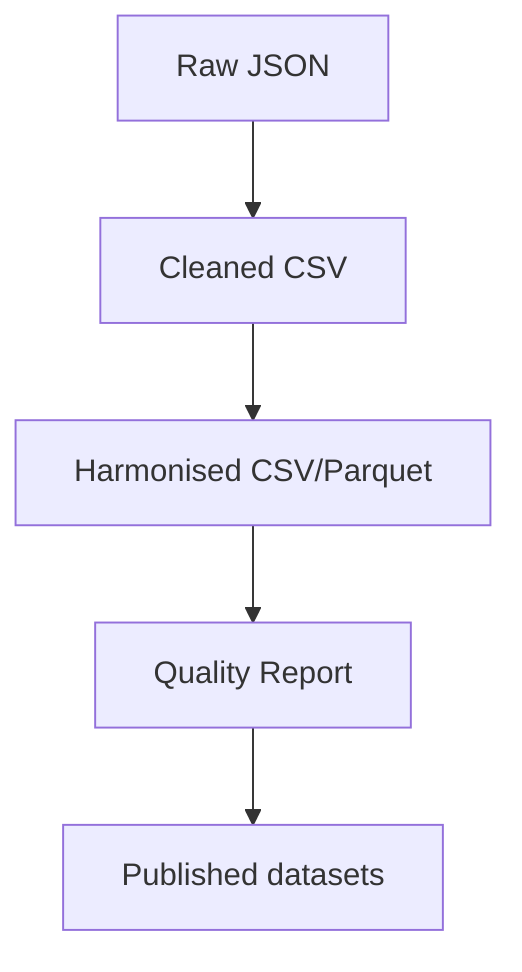
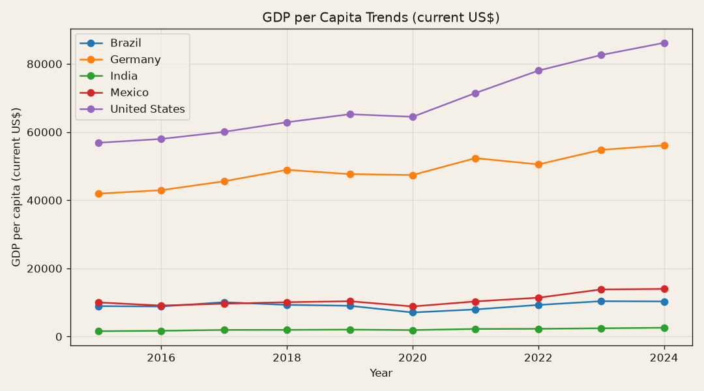
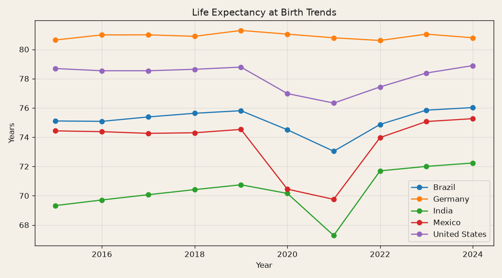
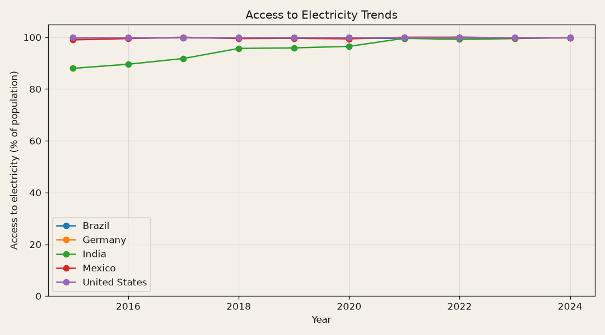
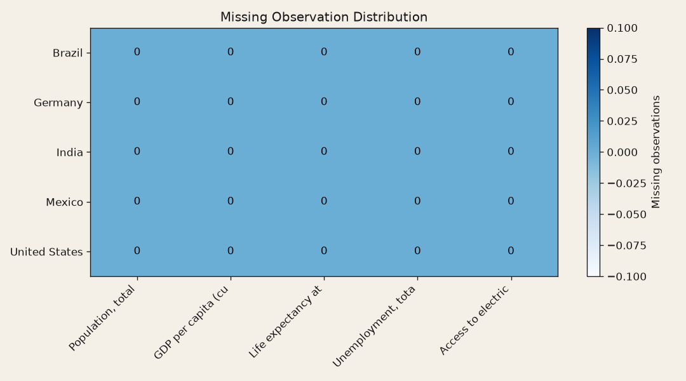
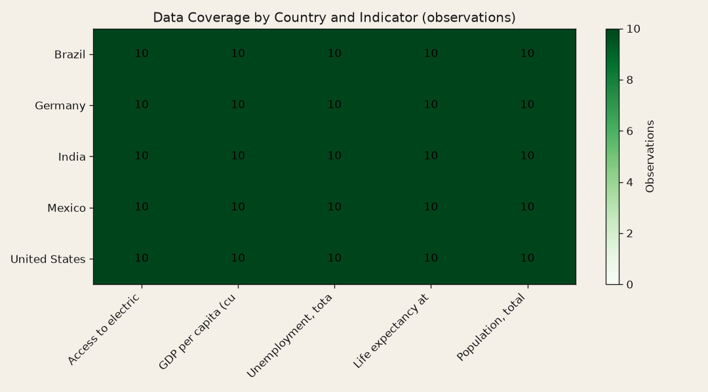
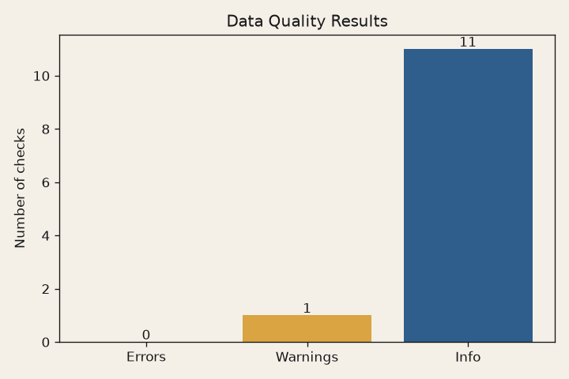

# Public Data Integration & Harmonization Pipeline


## Executive summary

This project is an independent portfolio Proof of Concept that demonstrates the practical responsibilities of a **Data Pipeline Specialist (Python, SQL)**: querying public APIs, preserving raw data, automating acquisition, cleaning, harmonizing, validating, and publishing analytics-ready datasets.

It integrates five World Bank indicators for five countries over 2015-2024 into a single, validated, analytics-ready dataset, and exposes the results through CSV, Parquet, DuckDB, SQL, charts, and documentation.

> This is an independent portfolio project. It is not an official YouthShare project and is not affiliated with or endorsed by YouthShare or any other organization. Only publicly available data is used.

## Business problem

Public socioeconomic data is freely available but fragmented, inconsistently structured, and rarely ready for direct analysis. Analysts lose time locating, cleaning, and reconciling datasets before producing insight. Decision-makers need comparable indicators across countries and years; without standardization, comparisons are misleading.

## Why public data integration is challenging

- Inconsistent schemas and column names across endpoints.
- Missing observations that must not be confused with zero.
- Mixed identifier systems (ISO-2 vs ISO-3, regional aggregates mixed with countries).
- Empty unit fields requiring documented canonical units.
- Pagination and transient network failures.
- Duplicate records and unexpected schema changes.

## Proposed solution

An automated four-layer pipeline:

1. **RAW**: retrieve and preserve original API responses.
2. **CLEANED**: normalize columns, types, missing values, duplicates.
3. **HARMONISED**: standardize country codes, names, years, units.
4. **PUBLISHED**: validate, then publish CSV, Parquet, DuckDB, plus data dictionary and charts.

## Architecture diagram



## Data lifecycle



## Technology stack

| Technology | Purpose |
|---|---|
| Python | Pipeline implementation |
| Pandas | Data transformation |
| Requests | API communication |
| PyArrow | Parquet |
| DuckDB | SQL analytics |
| Pytest | Automated testing |
| Matplotlib | Charts |
| Mermaid | Architecture diagrams |
| GitHub Actions | CI/CD and scheduled refresh |

## Data sources and indicators

Source: World Bank Indicators API v2 (`https://api.worldbank.org/v2`).

| Indicator | Identifier | Unit |
|---|---|---|
| Population, total | SP.POP.TOTL | People |
| GDP per capita | NY.GDP.PCAP.CD | Current US$ |
| Life expectancy at birth | SP.DYN.LE00.IN | Years |
| Unemployment, total | SL.UEM.TOTL.ZS | Percentage |
| Access to electricity | EG.ELC.ACCS.ZS | Percentage |

Countries: Mexico (MEX), United States (USA), Brazil (BRA), India (IND), Germany (DEU). Period: 2015-2024.

## Data quality framework

Automated checks: structural, completeness, uniqueness, validity, consistency, and time-series. A publication gate blocks publishing when any error-level check fails. Missing observations are reported as warnings/info, never treated as zero. Unusual year-over-year changes (>50%) are flagged as warnings, not errors.

See `docs/DATA_QUALITY.md`.

## Actual results

From the latest run:

- Countries processed: 5
- Indicators processed: 5
- Records extracted: 250
- Valid records: 250
- Missing observations: 0
- Rejected records: 0
- Quality errors: 0
- Quality warnings: 1 (USA unemployment 2020 spike, +119.5%)
- Tests: 28 passing

Generated outputs: `data/published/harmonised_dataset.csv`, `.parquet`, `analytics.duckdb`, `data_dictionary.csv`, `run_summary.json`, `data/quality/quality_report.json`, and 8 charts in `reports/figures/`.

## Analytical insights

- Population grows steadily across all five countries; India and the US are the largest.
- GDP per capita (current US$) is highest in the United States and Germany; gaps are large and persistent.
- Life expectancy is highest in Germany; India shows the largest improvement over the period.
- Unemployment spiked in the United States in 2020 (COVID-19), flagged as an unusual change.
- Electricity access is near-universal in MEX/USA/BRA/DEU; India shows strong progress toward universal access.

## Visualizations

### Population comparison


### GDP per capita trends



### Life expectancy trends



### Unemployment comparison


### Electricity access trends



### Missing observation distribution



### Data coverage by country and indicator



### Data quality results



## Repository structure

```
.
├── .github/workflows/      # CI and scheduled refresh
├── data/                   # raw, cleaned, harmonised, published, quality
├── docs/                   # supporting documentation
├── reports/figures/        # generated charts
├── sql/                    # DuckDB analytical queries
├── src/pipeline/           # pipeline source code
├── tests/                  # unit, integration, e2e tests
├── main.py                 # entry point
├── requirements.txt
└── pyproject.toml
```

## Installation instructions

```bash
git clone https://github.com/Raf-Hs/public-data-integration-harmonization-pipeline.git
cd public-data-integration-harmonization-pipeline
python -m venv .venv
# Windows
.venv\Scripts\activate
# macOS/Linux
source .venv/bin/activate
pip install -r requirements.txt -r requirements-dev.txt
```

## Execution instructions

```bash
python main.py
```

Outputs are written to `data/` and `reports/figures/`.

## Testing

```bash
python -m pytest
```

28 tests pass. Tests use controlled fixtures and do not require live API access.

## Automation

- `ci.yml`: runs on push/PR, installs dependencies, compiles, runs tests.
- `scheduled_refresh.yml`: weekly Monday 06:00 UTC, runs pipeline, tests, and commits refreshed data.

## Limitations

See `docs/LIMITATIONS.md`. Fixed country/indicator scope, depends on API availability, static charts, embedded country metadata.

## Future improvements

- Add more countries and indicators via configuration.
- Add a dashboard (Looker Studio) on top of published CSV.
- Add incremental refresh and historical versioning.
- Add data contracts and schema validation with Pydantic.

## License

MIT
