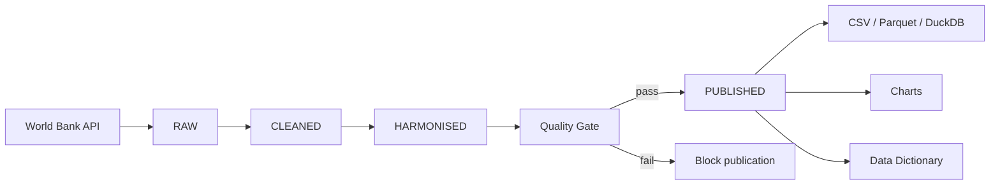

# Architecture

## High-level architecture

## Processing stages

1. **Extract** — query the World Bank API with pagination, retries, and timeouts; preserve raw JSON.
2. **Clean** — normalize columns, parse years, standardize missing values, detect duplicates, validate required fields.
3. **Harmonize** — standardize ISO-3 codes, country names, years, and units; attach public metadata.
4. **Validate** — run structural, completeness, uniqueness, validity, consistency, and time-series checks.
5. **Publish** — write CSV, Parquet, and DuckDB only when validation passes; generate the data dictionary.
6. **Analyze and visualize** — run DuckDB SQL queries and generate charts from published data.

## Automation

GitHub Actions provides CI on push and pull requests and a weekly scheduled refresh that reruns the pipeline, tests, and commits refreshed data when changes exist.
